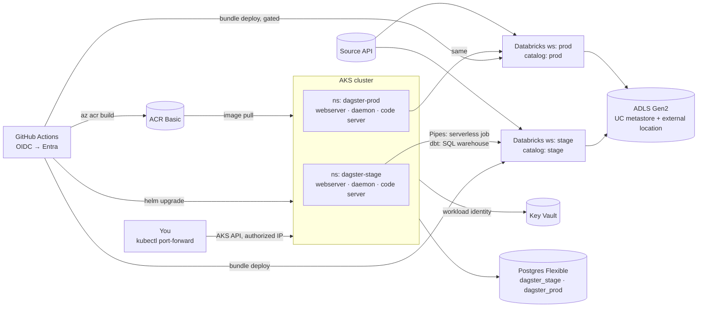

# Architecture

## One paragraph
Dagster OSS runs on a single AKS cluster (Free control plane, one node) with two
namespaces, `dagster-stage` and `dagster-prod`, each a separate Helm release of the same image.
Each release talks to its own Azure Databricks workspace (`stage`, `prod`) using a Databricks
service principal whose OAuth secret is mounted from Azure Key Vault. Dagster run state is in one
Azure Database for PostgreSQL Flexible Server with two databases. Databricks compute is serverless
only (a serverless job submitted via Dagster Pipes, and a 2X-Small SQL warehouse), so Databricks costs nothing when idle.
Nothing is exposed via public ingress; all control planes are public-but-Entra-gated and
IP-restricted. Private endpoints and VPN are deliberately deferred (see [corporate migration](corporate-migration.md)).

## Component diagram

## Data flow (per environment)
1. Dagster schedule/sensor (or manual launch) materializes `raw_<source>` (one asset per entry in
   `databricks/sources.yml`).
2. The asset uses `PipesDatabricksServerlessClient` to submit a one-off serverless notebook task
   (the entrypoint deployed by the Asset Bundle). The notebook calls the API and writes JSON to the
   landing volume `<catalog>.bronze.landing`, reporting row counts back as asset metadata.
3. Dagster then materializes the dbt models via `dagster-dbt`: `bronze_<source>` reads the landing
   files into `<catalog>.bronze`, and `silver_<source>` builds `<catalog>.silver`. `dbt build` runs
   inside the Dagster run pod against the SQL warehouse.

See [Dagster Pipes](concepts/dagster-pipes.md) and [medallion architecture](concepts/medallion-architecture.md).

## Identity flow
| From | To | Mechanism |
|---|---|---|
| GitHub Actions | Azure (ARM, ACR, AKS) | Workload identity federation: Entra app + federated credential for the repo/branch/environment. No stored cloud secret. |
| GitHub Actions | Databricks workspace | Entra token for the same app (`azure-client-id` + OIDC) via Databricks CLI unified auth. |
| Dagster pods | Key Vault | AKS workload identity → user-assigned managed identity → Key Vault Secrets User role. Secrets Store CSI driver mounts secrets as files / syncs to K8s Secret. |
| Dagster pods | Databricks workspace | Databricks service principal (one per workspace), OAuth M2M client ID + secret read from Key Vault. Upgrade path: federate the pod's managed identity directly (no secret). |
| Dagster pods | Postgres | Password from Key Vault for POC; upgrade path: Entra auth with the managed identity. |
| Databricks (UC) | ADLS Gen2 | Access Connector managed identity with Storage Blob Data Contributor on the account. |

## What is public vs. gated
| Endpoint | POC posture | Corporate posture |
|---|---|---|
| AKS API server | Public, Entra RBAC, authorized IP ranges = your IP | Private cluster |
| Dagster UI | Not exposed; port-forward only | Internal LB behind VPN/Bastion |
| ACR | Public, Entra auth, admin user disabled | Private endpoint, Premium |
| Key Vault | Public, RBAC, firewall to AKS egress IP + your IP | Private endpoint |
| Postgres | Public, firewall to AKS egress IP and your IP, TLS, password auth | Private access / PE |
| Databricks workspace UI/API | Public, Entra, IP access list | Front-end Private Link, public disabled |
| Databricks cluster plane | Serverless (Databricks-managed) | Serverless + NCC, or classic SCC in your VNet |
| Storage account | Public, firewall (your IP, access connectors) + network security perimeter, key auth disabled | Private endpoint |

## Parametrization contract
Everything environment-specific comes from exactly one of these places. Code never knows which env it is in.

| Value | Where it is set | Where it is read |
|---|---|---|
| Databricks host | `.env` → `scripts/helm-upgrade.sh` → env var `DATABRICKS_HOST` | `dagster/src/poc/assets/extract.py`, `dbt/profiles.yml` |
| SP client ID / secret | Key Vault → CSI → env vars | same |
| Catalog name | Helm env var `DBX_CATALOG`; bundle variable `catalog` | `assets/extract.py`, `dbt/profiles.yml`, dbt models |
| Bundle root (deployed notebook path) | Computed by `scripts/helm-upgrade.sh` as env var `DBX_BUNDLE_ROOT` | `assets/extract.py` |
| SQL warehouse HTTP path | Helm env var `DBX_WAREHOUSE_HTTP_PATH` | `dbt/profiles.yml` |
| Postgres host/db | Helm `postgresql.*` values | Dagster chart |
| Image tag | Helm `--set dagster-user-deployments.deployments[0].image.tag=<sha>` from CI | chart |
| Namespace | Helm `-n dagster-<env>` | — |

See [environment parametrization](concepts/environment-parametrization.md) for how each tool receives these values.
